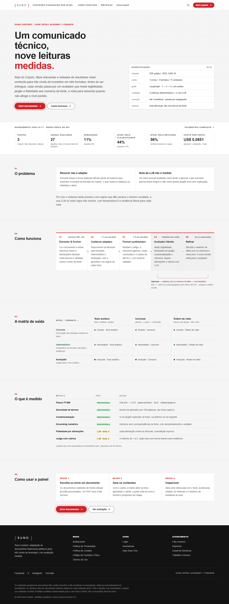
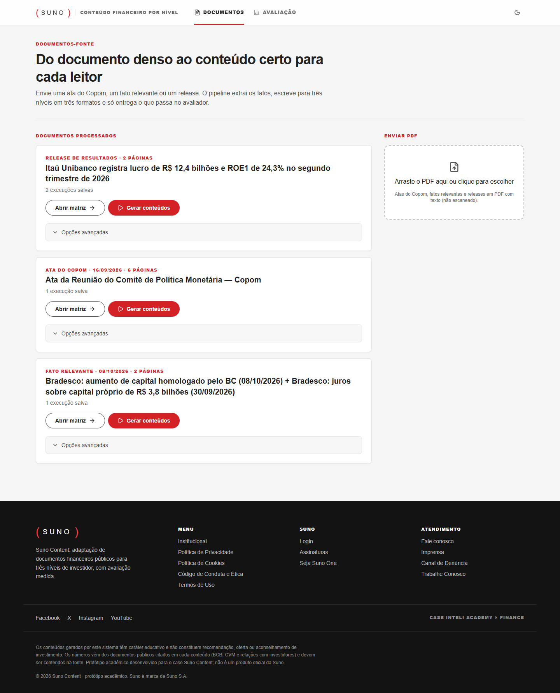
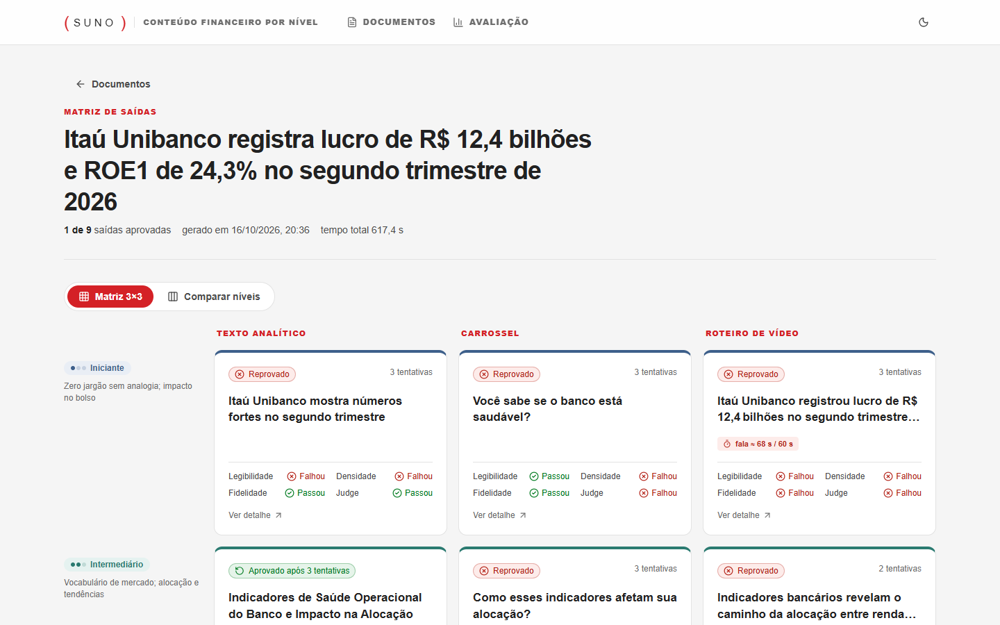
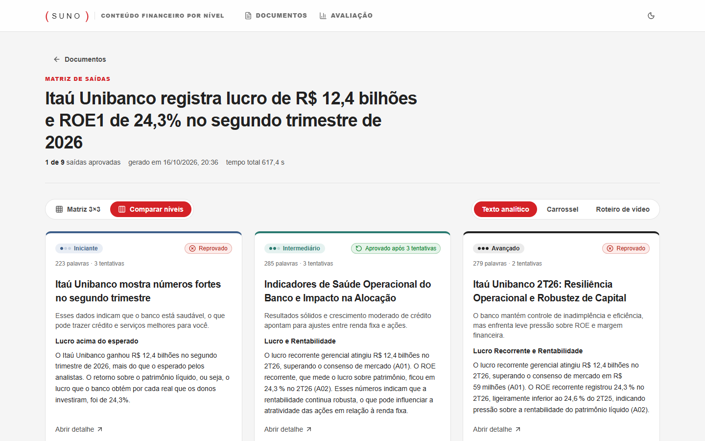
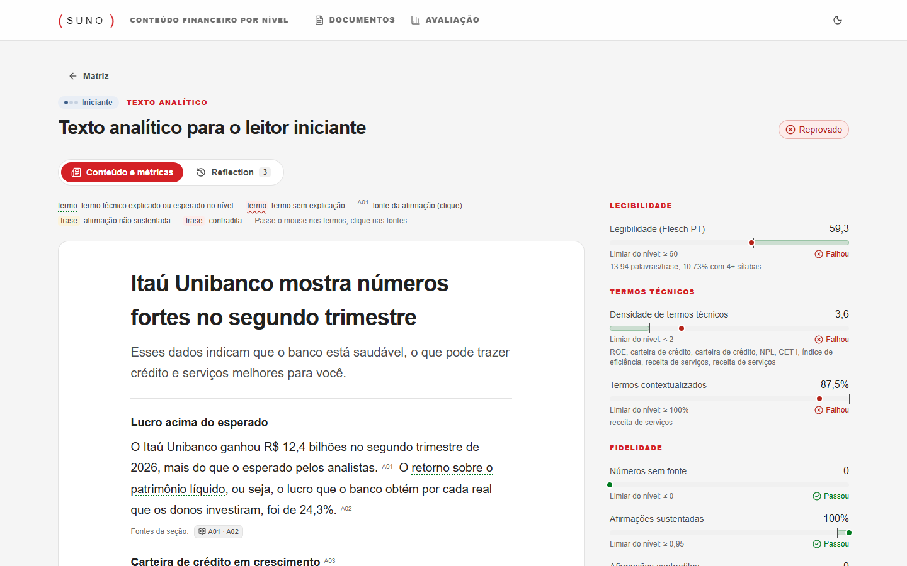
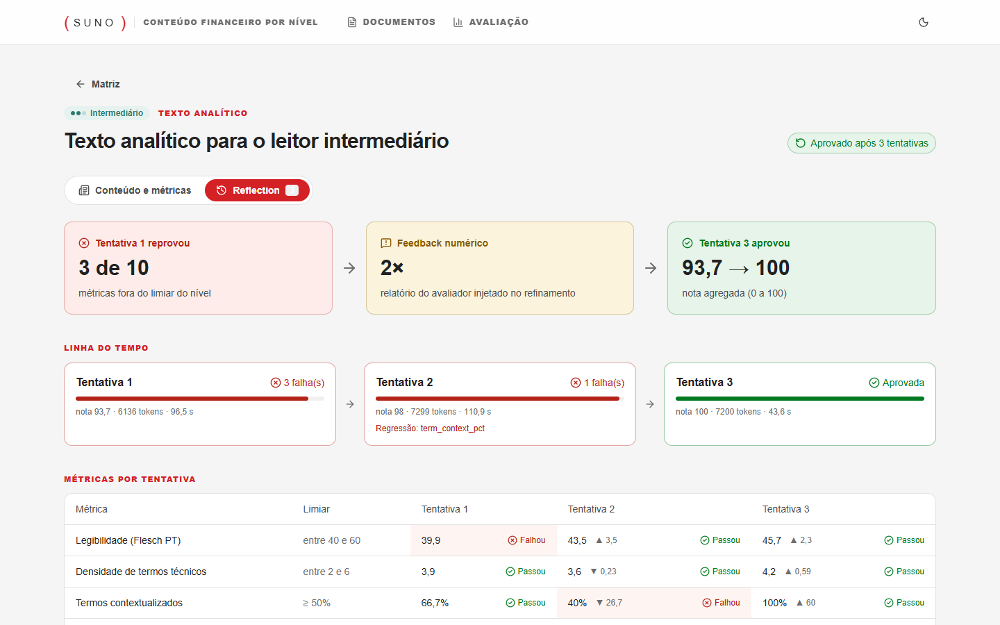
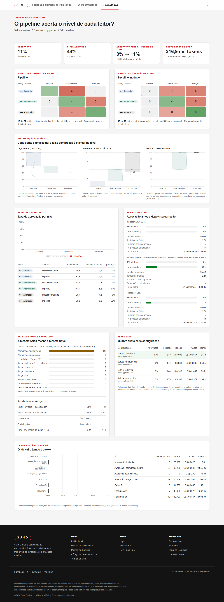
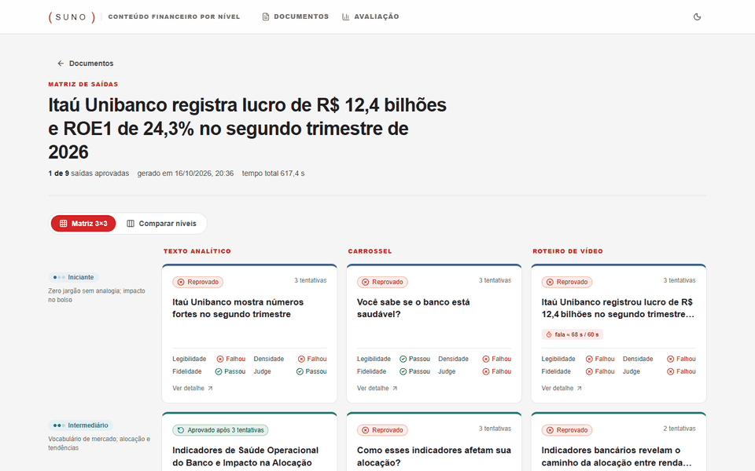
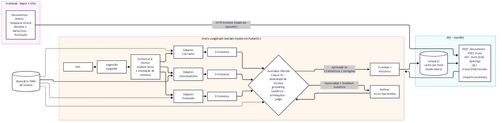

# Suno Content: documentação

Este documento reúne, num só lugar, o que é o sistema, como usar, como ele funciona por dentro, as decisões de arquitetura, os resultados do experimento, a estratégia de testes e os próximos passos. O [README](../README.md) é o resumo de entrada; os números do experimento vêm de [`resultados/`](resultados/relatorio_experimental.md), que é gerado automaticamente.

**Sumário:** 

[1. Visão geral](#1-visão-geral) 

[2. Como usar](#2-como-usar)

[3. Interface](#3-interface) 

[4. Arquitetura](#4-arquitetura) 

[5. Avaliação](#5-avaliação)

[6. Reflection loop](#6-reflection-loop)

[7. Dados, cache e configuração](#7-dados-cache-e-configuração) 

[8. API](#8-api) 

[9. Decisões de arquitetura](#9-decisões-de-arquitetura) 

[10. Resultados](#10-resultados) 

[11. Testes](#11-testes) 

[12. Limitações e próximos passos](#12-limitações-e-próximos-passos)

## 1. Visão geral

Atas do Copom, fatos relevantes e releases de resultados são escritos em linguagem técnica e densa. O Suno Content transforma cada documento em nove conteúdos, três níveis de investidor (Iniciante, Intermediário e Avançado) em três formatos (texto analítico, carrossel e roteiro de vídeo de até 60 segundos), e mede cada um antes de entregar.

O problema que o projeto ataca tem duas partes. A primeira é que resumir não é adaptar: encurtar frases e trocar palavras perde as nuances que importam ou infantiliza o leitor. A segunda é que pedir a outro LLM que dê uma nota não é medir: a nota tende a ser complacente, favorece textos longos e não conta quanto jargão ficou sem explicação. Por isso, toda afirmação gerada parte de uma âncora factual validada contra a fonte, a avaliação começa por métricas determinísticas (o LLM entra só onde regra não resolve, com temperatura 0 e evidência literal) e as saídas reprovadas voltam para reescrita com feedback numérico.

O Iniciante não recebe termo técnico sem analogia cotidiana e o foco é o impacto no bolso; o Intermediário usa o vocabulário padrão de mercado (CDI, Selic, IPCA, dividendos) e fala de alocação e tendências; o Avançado preserva o jargão pleno (curva de juros, *forward guidance*, hiato do produto) com foco analítico. O texto analítico tem título, linha fina e três a cinco seções; o carrossel tem de cinco a oito slides com gancho, corpo e conclusão; o roteiro tem blocos com marcação de tempo, gancho visual e fala de até cerca de 150 palavras. As regras ficam em `backend/prompts/rules_<nivel>.md`, e nenhum conteúdo recomenda compra ou venda.

## 2. Como usar

O projeto roda no Windows, no macOS e no Linux e precisa de Python 3.11 a 3.13 com [uv](https://docs.astral.sh/uv/) e de Node.js 20.19+ ou 22. A chave de um provedor de LLM só é necessária para gerar conteúdo novo, porque o dashboard serve as execuções já gravadas. A instalação é feita com `uv sync --all-extras` (que instala também o modelo spaCy `pt_core_news_lg`), `npm ci` dentro de `frontend/` e a cópia dos arquivos `.env.example` para `.env` na raiz e em `frontend/`. No `.env` da raiz ficam os modelos, no formato `provedor:modelo`, e a chave do provedor.

Para abrir o dashboard, o atalho é `powershell -ExecutionPolicy Bypass -File scripts\demo.ps1` no Windows ou `scripts/demo.sh` no macOS e no Linux, que instalam, testam, sobem a API e o frontend e abrem o navegador. Também dá para subir em dois terminais: `uv run uvicorn backend.api.main:app --port 8000` na raiz e `npm run dev -- --port 5173 --strictPort` dentro de `frontend/`. O endereço é http://localhost:5173; a API responde em http://localhost:8000/docs, e a raiz `:8000/` devolve 404 de propósito. O navegador nunca chama a porta 8000: ele chama `/api` na porta 5173, e o Vite repassa a requisição, o que elimina problemas de CORS e de bloqueadores de anúncio.

Para gerar conteúdo novo, o coletor baixa documentos oficiais: `uv run python -m backend.ingestion.sources copom --quantidade 1` traz a última ata do Copom pela API do Banco Central, e `... fato-relevante --empresa bradesco --ano 2026` traz fatos relevantes pelos dados abertos da CVM (com `--listar`, só lista os candidatos). PDFs também podem ser colocados à mão em `data/raw/` seguindo a convenção de nome (`ata-copom-AAAA-MM-DD.pdf`, `fato-relevante-<empresa>-AAAA-MM-DD.pdf`, `release-<empresa>-<trimestre>.pdf`), da qual saem o tipo e a data. Em seguida, `uv run python -m backend.ingestion.cli` converte os PDFs em `data/processed/<id>.json`, e `uv run python -m backend.run --doc <id>` roda o grafo completo, usando o cache quando nada mudou. As opções mais usadas são `--force` (ignora o cache), `--doc <id1> --doc <id2>` (junta dois PDFs numa fonte única, como os dois fatos relevantes do Bradesco), `--no-llm-eval` (avaliação só determinística) e `--force-drift iniciante` (gera o Iniciante com as regras do Avançado para demonstrar o loop, visível com `uv run python -m backend.reflection.show --doc <id>`).

O experimento completo é um único comando, `uv run python -m backend.experiments`, com os documentos em `--doc` (use `id1+id2` para juntar dois PDFs), o documento da revisão humana em `--human-doc` e etapas que podem ser puladas com `--skip`. Tudo vai para `outputs/experiment/<data>/`. Com `--data AAAA-MM-DD` a etapa roda sobre uma pasta existente, e `--retomar` continua de onde parou depois de uma queda, lendo o checkpoint de cada documento. Depois da revisão humana, `uv run python -m backend.experiments.human_agreement outputs/experiment/<data>` calcula a concordância, `uv run python scripts/preencher_numeros.py` leva os números para o README e para `docs/resultados/`, e `uv run --group docs python scripts/capturar_telas.py` atualiza as capturas de tela.

Os problemas mais comuns têm causa conhecida. "A API não respondeu" no dashboard significa que a API não subiu, ainda está carregando o spaCy ou que `frontend/.env` não tem `VITE_API_URL=/api`. "LLM_FAST_MODEL não configurado" pede os modelos no `.env`. Um erro 429 longo indica cota diária do provedor esgotada: o cliente espera e tenta de novo, mas a cota só volta depois, e separar os papéis entre modelos (`LLM_JUDGE_MODEL`, `LLM_CLAIMS_MODEL`) ou usar `LLM_REASONING_EFFORT=low` reduz o consumo. Porta ocupada se resolve encerrando o processo antigo (`netstat -ano | findstr :8000` e `taskkill /PID <pid> /F` no Windows).

## 3. Interface

A página inicial (`/`) explica o sistema: especificação, números do experimento lidos da API, o pipeline etapa por etapa, a matriz de saída e as métricas. O painel começa em **Documentos** (`/documentos`), que lista as fontes processadas, aceita o envio de um PDF e gera os conteúdos com progresso por etapa; sem a opção "ignorar o cache", a execução gravada abre na hora e sem custo.

A **matriz** mostra as nove células com status, número de tentativas e as métricas principais; nos roteiros, um selo mostra a fala estimada contra o limite de 60 s. A alternância **Comparar níveis** coloca o mesmo formato lado a lado nos três públicos.

O **detalhe** de uma célula mostra o conteúdo com os termos do glossário destacados (verde quando explicados, vermelho quando não), cada afirmação ligada ao trecho e à página da fonte e cada métrica contra o seu limiar. A aba **Reflection** mostra as tentativas, as métricas antes e depois, o feedback injetado e o diff do texto.

A tela **Avaliação** (`/avaliacao`) junta a telemetria: aprovação e acerto de nível do pipeline contra o baseline, matrizes de confusão, distribuição das métricas por nível com as faixas de limiar, o ganho do loop por documento, a confiabilidade do avaliador (variância e revisão humana), os trade-offs de configuração e o custo e a latência por nó.

## 4. Arquitetura

O sistema tem quatro camadas. A **ingestão** (`backend/ingestion/`) baixa os documentos oficiais e extrai o texto: o PyMuPDF lê os blocos, remove cabeçalhos e rodapés repetidos em pelo menos metade das páginas e números de página isolados, desfaz a hifenização e produz um `SourceDocument` com as páginas preservadas. O **pipeline** (`backend/graph/`, `backend/nodes/`, `backend/prompts/`) é um `StateGraph` do LangGraph. A **avaliação** (`backend/evaluator/`, `backend/reflection/`, `backend/experiments/`) contém as métricas, o loop e o experimento. A **interface** (`backend/api/` e `frontend/`) é uma API FastAPI sobre as execuções salvas e um dashboard em React 19, Vite, TypeScript, Tailwind, TanStack Query e Recharts, com cliente HTTP tipado a partir do OpenAPI da API.

O grafo segue um fan-out fixo. O **Extractor & Anchor** (modelo forte) extrai os pontos centrais e as âncoras factuais, cada uma com afirmação, números, trecho literal e página; todo número é conferido no texto da fonte, e âncora com número inexistente fica inválida. Três **adapters** (modelo barato, em paralelo) reescrevem o conteúdo para cada nível usando só as âncoras válidas, as regras do nível e dicas do glossário. Nove **formatters** (modelo barato, em paralelo) montam texto, carrossel e roteiro com saída estruturada validada por Pydantic e com os `anchor_ids` usados em cada trecho. O **avaliador híbrido** avalia em paralelo as células pendentes e decide, por célula, entre aprovar, refinar ou encerrar; o **refiner** reescreve só as reprovadas e devolve ao avaliador. Formatter e refiner repetem a chamada uma vez com o modelo forte quando o barato não entrega um JSON válido. Ao final, o estado vira um `RunRecord` em `outputs/<doc_id>/<timestamp>.json`, com telemetria de tokens, custo e latência por nó.

O `GraphState` é o único objeto que circula entre os nós. Os campos escritos por ramos paralelos (`adapted`, `outputs`, `reports`, `history`, `final_status`, `attempts`) são dicionários com reducer de mescla, e `warnings` e `node_log` são listas concatenadas; a chave de cada célula é `"<nível>:<formato>"`. Os contratos ficam em `backend/schemas/`: documento e âncoras, corpo de cada formato (com validações como 5 a 8 slides e blocos de roteiro sem sobreposição), relatório de avaliação (cada métrica com valor, limiar e direção `min`, `max`, `range` ou `info`) e o histórico de tentativas. O texto avaliado depende do formato: o artigo inteiro, os slides concatenados ou só a fala do roteiro.

Os prompts são arquivos `.md` versionados, um por nó e por nível, com o prompt de sistema, a linha `---USER---` e o template do usuário; as variáveis usam `$nome`, e uma variável faltando gera erro imediato. O hash dos prompts entra na chave de cache. O cliente de LLM usa saída estruturada (`json_schema` no Groq), reenvia com o erro como feedback quando a saída não valida (até 3 vezes) e, em limite de taxa, espera o tempo indicado pelo provedor ou faz backoff exponencial.

## 5. Avaliação

Cada saída passa por todas as métricas, nesta ordem. As determinísticas vêm primeiro. A **legibilidade** (`flesch_pt`) usa a adaptação de Martins et al. para o português, `248,835 − 1,015 × (palavras/frase) − 84,6 × (sílabas/palavra)`, com sílabas pelo `pyphen` pt_BR. A **densidade de termos** (`term_density`) conta termos do glossário por 100 palavras, casando por lema do spaCy. A **contextualização** (`term_context_pct`) é o percentual de termos acima do nível do texto que têm explicação na mesma frase, na anterior (marcadores como "ou seja", "isto é", "na prática", parênteses) ou na seguinte, quando ela retoma o termo por anáfora ("Esse lucro…"). O **grounding numérico** (`numeric_grounding`) conta números sem correspondência na fonte nem nas âncoras, com tolerância de 0,5% e aceitando arredondamento e troca de unidade ("12,4 bi" equivale a "12.407 milhões").

Depois entram as métricas com LLM, sempre com temperatura 0. O checker de **fidelidade** quebra o texto em afirmações atômicas e classifica cada uma como sustentada, não sustentada ou contradita pelas âncoras citadas (`claim_support` e `claim_contradictions`; uma contradição reprova). O **judge**, de outra família de modelo, dá notas de 1 a 5 para adequação ao público, tom, nuances e formato, cada uma com um trecho literal como evidência; o tamanho do texto não é critério, e "nuances" mede distorção, não cobertura. Textos com menos de 100 palavras recebem a flag `baixa_confiabilidade`. O **nível previsto** de cada saída usa só legibilidade e densidade, que não dependem do nível pedido, e alimenta a matriz de confusão.

| Métrica | Iniciante | Intermediário | Avançado |
|---|---|---|---|
| Legibilidade (`flesch_pt`) | ≥ 60 | 40 a 60 | só reporta |
| Densidade de termos | ≤ 2 | 2 a 6 | ≥ 5 |
| Contextualização (%) | ≥ 100 | ≥ 50 | só reporta |
| Números sem fonte | 0 | 0 | 0 |
| Afirmações sustentadas | ≥ 0,95 | ≥ 0,95 | ≥ 0,95 |
| Contradições | 0 | 0 | 0 |
| Judge (cada critério) | ≥ 4 | ≥ 4 | ≥ 4 |

Os limiares ficam em `backend/evaluator/thresholds.yaml`, com faixas por nível, sobrescritas opcionais por formato e a configuração do classificador. Os valores iniciais vêm do briefing, e o notebook `notebooks/calibracao_limiares.ipynb` confere se eles separam os casos do conjunto golden (textos escritos à mão para cada nível e para cada defeito); a calibração não usou as saídas do experimento. O glossário (`data/glossary/glossario.yaml`) tem 93 termos, cada um com variações, nível mínimo a partir do qual dispensa explicação e analogia para o Iniciante.

## 6. Reflection loop

Depois da primeira avaliação, só as células reprovadas vão para o refiner. O feedback é gerado das próprias métricas, sem LLM, com o valor, o limiar, a causa e o trecho (por exemplo, "Flesch 27 < 60; frases com média de 17 palavras, encurte para ~15; 'Selic' sem explicação na frase 1"). O refiner reescreve com o texto anterior, o feedback, as âncoras e o glossário, e o avaliador roda de novo. Uma nota agregada de 0 a 1 resume cada tentativa: cada métrica aprovada vale 1, e uma reprovada vale `1 − distância ao limiar / max(|limiar|, 1)`.

A célula para quando é aprovada, quando chega a três tentativas (contando a primeira) ou quando a nota agregada sobe menos de 0,01 entre duas tentativas. Sem aprovação, entrega-se a tentativa de maior nota, e métricas que passavam e passaram a falhar ficam registradas como regressão. Para demonstrar o mecanismo de propósito, `--force-drift iniciante` gera o Iniciante com as regras do Avançado na primeira tentativa, e o loop precisa trazê-lo de volta ao nível.

## 7. Dados, cache e configuração

Os PDFs ficam em `data/raw/` (fora do git, recriáveis pelo coletor) e o texto processado em `data/processed/`. Cada execução vai para `outputs/<doc_id>/<timestamp>.json`; o baseline, para `outputs/<doc_id>/baseline/`; a demonstração do loop, para `outputs/demo/`; e o experimento, para `outputs/experiment/<data>/` (manifesto, execuções, CSVs, figuras e relatório). O CLI só reaproveita uma execução quando a chave de cache bate: hash dos prompts, do glossário, dos prompts do avaliador e dos limiares, modelos por papel e `force_drift`. A API, ao contrário, serve a execução mais recente do documento sem conferir os hashes, para que execuções gravadas continuem navegáveis depois de mudanças em prompts; é esse modo que permite gravar a demonstração sem chamar o LLM.

Os modelos são configurados por papel no `.env`. `LLM_FAST_MODEL` atende adapters, formatters, refiner e baseline; `LLM_STRONG_MODEL` atende o extractor e o fallback de schema; `LLM_JUDGE_MODEL` (vazio usa o forte) atende o judge; e `LLM_CLAIMS_MODEL` (vazio usa o judge) atende o checker de afirmações. O experimento usou `groq:openai/gpt-oss-20b` como barato, `groq:openai/gpt-oss-120b` como forte e no checker e `groq:qwen/qwen3.8-27b` como judge; outros provedores (Gemini, OpenAI, Anthropic) funcionam trocando o `.env` e a chave correspondente. As demais variáveis são `LLM_TEMPERATURE` (0,2 na geração; a avaliação usa 0), `LLM_REASONING_EFFORT` (para modelos gpt-oss), `MAX_RETRIES` (3) e `REFLECTION_EPSILON` (0,01). Os preços por milhão de tokens usados na telemetria ficam em `backend/model_prices.yaml`.

## 8. API

A API está em `backend/api/main.py`, sem autenticação (uso local) e com CORS liberado só para `http://localhost:5173`. A documentação interativa fica em http://localhost:8000/docs. Execuções salvas têm identificador persistente `<doc_id>__<arquivo>` e continuam acessíveis depois de reiniciar a API; execuções novas recebem um identificador temporário enquanto rodam e passam ao persistente quando terminam.

| Método e rota | O que faz |
|---|---|
| `GET /documents` | Lista as fontes processadas (fontes compostas aparecem uma vez, sem as partes) |
| `POST /documents` | Recebe um PDF (multipart, campo `file`) e o ingere; 415 se não for PDF, 422 se não tiver texto |
| `GET /documents/{doc_id}/anchors` | Âncoras factuais da execução mais recente |
| `POST /runs` | Serve a execução salva ou, com `force: true`, roda o grafo em segundo plano; `force_drift` ativa a demonstração do loop |
| `GET /runs/{run_id}` | Status e progresso por etapa (extractor, adapters, formatters, avaliador) |
| `GET /runs/{run_id}/results` | Matriz com conteúdo, relatório, histórico de tentativas e telemetria |
| `GET /runs/{run_id}/cells/{nível}/{formato}/terms` | Termos do glossário no texto, com trecho e se foram explicados |
| `GET /reports/summary` | Pipeline × baseline, matrizes de confusão, reflection e custo por nó; documentos do experimento usam a execução do experimento |
| `GET /reports/experiment` | Variância do avaliador, trade-offs e concordância humana do experimento |
| `GET /glossary`, `GET /thresholds` | Glossário e limiares |

Depois de mudar um modelo de resposta, `uv run python -m backend.api.export_openapi` e `npm run gen:api` (em `frontend/`) regeneram os tipos do cliente.

## 9. Decisões de arquitetura

**Grafo com fan-out estático.** Gerar as nove saídas em série deixaria cada execução lenta, e o case pede um sistema em grafo com estado. O `StateGraph` com arestas fixas (1 extractor, 3 adapters e 9 formatters em paralelo, com aresta condicional para o refiner) torna a topologia visível no código e no diagrama e dá o progresso por nó de graça. Foram descartados o `Send` dinâmico, que esconde a topologia até a execução, e um script sequencial, sem paralelismo nem estado compartilhado. O custo é que incluir um nível ou formato exige editar `backend/graph/build.py`.

**Âncoras factuais como base da rastreabilidade.** Conteúdo simplificado tende a perder ou inventar números. Em vez de passar o PDF inteiro a cada nó, o extractor produz âncoras validadas numericamente (formato brasileiro, `Decimal`, escalas de mil a bilhão, pontos percentuais e pontos-base), e cada trecho gerado declara as âncoras que usou. O que o extractor não ancorou não chega ao conteúdo: o projeto prefere perder cobertura a perder fidelidade, e por isso o extractor usa o modelo forte.

**Métricas determinísticas antes do LLM.** Uma nota só de LLM é cara, varia entre execuções e não mede densidade de jargão. As métricas determinísticas dão sempre a mesma nota para a mesma entrada e geram um feedback reprodutível; o judge continua no circuito, mas como uma métrica entre várias. A contrapartida é que métricas de superfície não medem qualidade didática, e é por isso que o judge existe.

**Flesch próprio para o português.** O `textstat` aplica a constante do inglês mesmo com idioma português e dá cerca de 30 pontos a menos, reprovando textos simples. A implementação própria usa a fórmula de Martins et al.; o erro conhecido é a silabação de hiatos pelo `pyphen` ("monetária" conta quatro sílabas), documentado em teste.

**Papéis de modelo configuráveis.** Nem toda etapa precisa do modelo mais caro, o judge não deve ser o mesmo modelo que gera, e os provedores limitam o consumo por modelo. Os quatro papéis (barato, forte, judge e checker) se trocam pelo `.env`, sem mudar código. O judge de outra família reduz o viés de autoavaliação, ao custo de introduzir a variância de um segundo modelo, e o fallback para o modelo forte só encarece as células que falhariam.

**Reflection só nas reprovadas.** Regerar as nove saídas a cada falha multiplicaria o custo e poderia piorar o que já estava bom. Com o loop restrito às reprovadas, o custo é previsível e cada tentativa fica auditável; o preço é que uma célula aprovada no limite não é melhorada e a parada por estagnação pode encerrar cedo um caso que melhoraria.

**Modo demonstração sobre o cache.** Como o vídeo é critério eliminatório, a API serve execuções gravadas sem chamar o LLM, e os scripts de demonstração sobem tudo a partir de um clone limpo. A demonstração mostra execuções reais, mas gravadas.

**Coleta das fontes oficiais, sem RAG.** A coleta pela API do Banco Central e pelos dados abertos da CVM torna o corpus reproduzível e mantém a paginação usada pela rastreabilidade. RAG não foi adotado porque cada documento cabe inteiro no contexto do extractor (a ata tem cerca de 14 mil caracteres) e as âncoras já fazem o papel de trechos recuperados, com validação numérica; ele passa a fazer sentido se o produto evoluir para perguntas sobre muitos documentos, como o histórico de atas.

**Calibração do avaliador.** A primeira execução real reprovou todas as células por três causas que não eram defeitos do texto: o judge cobrava cobertura em "nuances", a contextualização não aceitava a explicação na frase seguinte e o modelo barato às vezes devolvia JSON inválido no refiner. O critério de nuances passou a medir só distorção do que está no texto, a janela de contextualização passou a aceitar a frase seguinte com anáfora e formatter e refiner ganharam o fallback para o modelo forte. Os limiares não mudaram.

## 10. Resultados

O experimento foi feito sobre três fontes reais coletadas das fontes oficiais: a ata do Copom de 16/09/2026, o release de resultados do Itaú do 2T26 e dois fatos relevantes do Bradesco reunidos numa fonte única. O baseline é um prompt único ("resuma para um investidor X no formato Y"), sem extractor, âncoras ou glossário, com o mesmo modelo de geração, e pipeline e baseline passam pela mesma suíte de avaliação, incluindo o checker de afirmações e o judge. O relatório completo, com todas as tabelas e o manifesto de reprodutibilidade, está em [`resultados/relatorio_experimental.md`](resultados/relatorio_experimental.md).

O pipeline acerta o nível em 44% das 27 saídas, contra 37% do baseline, e aprova 11% contra 0%. O ganho mais claro é a fidelidade: as afirmações sustentadas pelas âncoras ficam em torno de 92% no pipeline e 62% no baseline. No Iniciante, o pipeline escreve mais fácil, usa menos jargão e explica a maior parte dos termos que mantém, mas nenhum dos dois sistemas aprova esse nível, porque o limite de 2 termos técnicos por 100 palavras é o critério mais difícil. O classificador de nível usa só legibilidade e densidade, o que limita a separação entre Intermediário e Avançado em textos curtos.

O reflection loop levou a aprovação de 0% na primeira tentativa para 11% ao final, com 2,56 tentativas por saída em média: 22% no Bradesco, 11% no Itaú e 0% no Copom, o documento mais técnico. Foram registradas 30 regressões, casos em que o refiner corrige a métrica apontada e piora outra que passava. Uma execução do pipeline custa em média US$ 0,085 por fonte (cerca de 173 mil tokens, 73 chamadas e 11 minutos), e o experimento inteiro custou US$ 0,46. A latência é dominada pelo limite de tokens por minuto do provedor, não pelo código; o checker de afirmações é o nó mais demorado.

Na **variância do avaliador**, as nove saídas do Itaú foram avaliadas duas vezes. As métricas determinísticas e o judge deram exatamente as mesmas notas; a fonte de ruído é o checker de afirmações, que mudou a nota em 5 das 9 saídas (diferença de até 0,25) e, com o limiar de 0,95, virou o veredito dessa métrica em 3 delas. Aprovações decididas por pouco em fidelidade devem ser lidas com essa margem.

Nos **trade-offs**, também sobre o Itaú, trocar o modelo de geração pelo forte não melhorou a qualidade medida e custou mais: 28% a mais de custo, 68% a mais de tempo, fidelidade menor (86% contra 91%) e nenhuma saída aprovada. O loop é o que mais pesa na geração barata, levando a aprovação de 0% para 11% e a fidelidade de 84% para 91%, ao custo de cerca de 2,5 vezes os tokens. A variante sem loop é a primeira tentativa de cada execução, que é exatamente o que o grafo produz com uma tentativa só. A configuração adotada (gerar com o modelo barato e reservar o forte para extrair, checar afirmações e servir de fallback) é a de melhor relação entre qualidade e custo, ainda que, com nove saídas, a diferença de aprovação seja de uma saída.

Na **revisão humana**, uma revisora avaliou às cegas as nove saídas do Itaú. O nível que ela percebeu coincide com o nível pedido na geração em 5 de 9 saídas (56%), mas com o classificador automático em só 3 de 9 (33%): os textos atingem o público pedido mais do que o classificador consegue detectar, e o acerto de nível do pipeline pode estar subestimado. No tom, o judge ficou a 0,11 ponto da revisora, em média, na escala de 1 a 5. Erro factual e trivialização não foram avaliados nesta rodada.

## 11. Testes

A suíte prova, sem gastar tokens, que o grafo produz e corrige a matriz 3×3 e que o avaliador mede o que diz medir. São 150 testes offline em Python, que usam um LLM falso (`tests/fakes.FakeLLM`, que devolve objetos válidos por schema e simula judge com nota baixa, contradição e roteiro longo), um avaliador roteirizado para exercitar cada ramo do loop e um transporte HTTP falso para as APIs do Banco Central e da CVM. Três testes de integração (`pytest -m integration`) chamam o provedor de verdade, e oito testes de componentes cobrem o frontend com Vitest. O CI (`.github/workflows/ci.yml`) roda lint, testes e build a cada push.

Os testes unitários cobrem sílabas, frases e a fórmula do Flesch calculada à mão, a janela de contextualização, o grounding numérico com arredondamento e unidades, o glossário, os contratos Pydantic, a renderização dos prompts, o coletor, o cliente de LLM e a ingestão de PDF. O conjunto golden (`tests/fixtures/golden/`) tem textos escritos à mão para cada caso que o avaliador precisa distinguir, como o avançado trivializado, o intermediário com jargão sem explicação e o iniciante com número inventado, e os testes afirmam a decisão esperada de cada métrica. Os testes ponta a ponta cobrem o grafo, o loop, o cache, a API e o experimento completo, incluindo a retomada depois de uma queda e as etapas complementares. Os comandos são `uv run pytest`, `uv run ruff check backend tests scripts` e, em `frontend/`, `npm test`, `npm run lint` e `npm run build`.

## 12. Limitações e próximos passos

Os limiares vêm do briefing e foram conferidos só no conjunto golden, sem calibração com textos de referência reais. A amostra é pequena (três fontes, nove saídas por fonte), então as taxas têm intervalo de confiança largo; a variância, os trade-offs e a revisão humana foram feitos sobre um documento e por uma revisora. O nível previsto usa só duas métricas, e textos curtos têm baixa confiabilidade. A silabação erra alguns hiatos, deixando o Flesch levemente otimista. O formato de roteiro limita a marcação de tempo a 60 s, mas a fala estimada de 7 dos 9 roteiros entregues passa desse tempo a 150 palavras por minuto; o limite de palavras é só registrado como aviso e ainda não entra no loop. Dos 93 termos do glossário, 73 aguardam revisão.

No código, a principal dívida é que um erro em uma célula do avaliador (por exemplo, cota do LLM esgotada) derruba a execução inteira; a correção é encerrar só a célula com um aviso. A API não tem autenticação nem limite de tamanho de upload, o que é aceitável para uso local, e o registro de execuções em andamento fica só em memória. O frontend tem poucos testes de interação e nenhum teste E2E, e níveis e formatos são fixos no grafo.

Os próximos passos, em ordem, são: tornar o avaliador tolerante a falha por célula e transformar a duração da fala do roteiro em métrica do loop; repetir a variância, os trade-offs e a revisão humana nos outros tipos de documento e com mais de um revisor; calibrar os limiares com textos de referência por nível e revisar o glossário; e, no produto, persistir o registro de execuções, adicionar testes E2E com Playwright e tornar níveis e formatos configuráveis. RAG e novas fontes (relatórios de inflação, releases via RI) são evoluções para quando o produto passar a trabalhar com muitos documentos.
