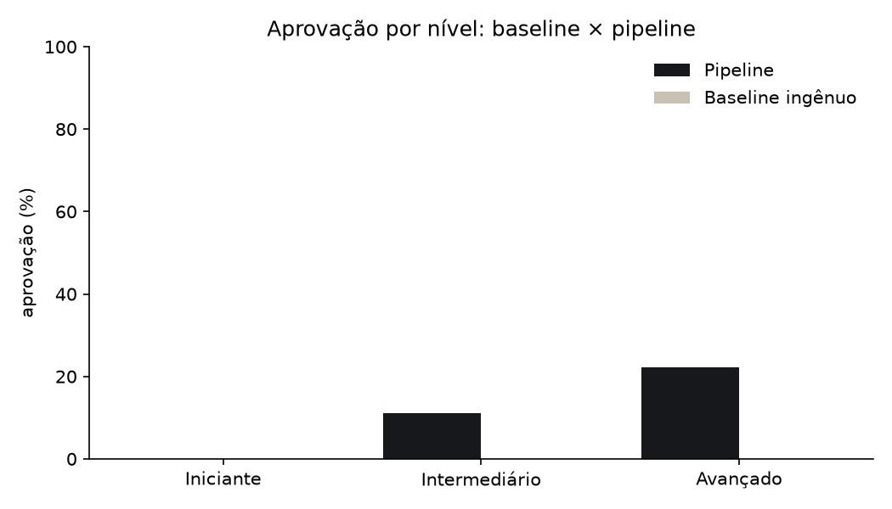
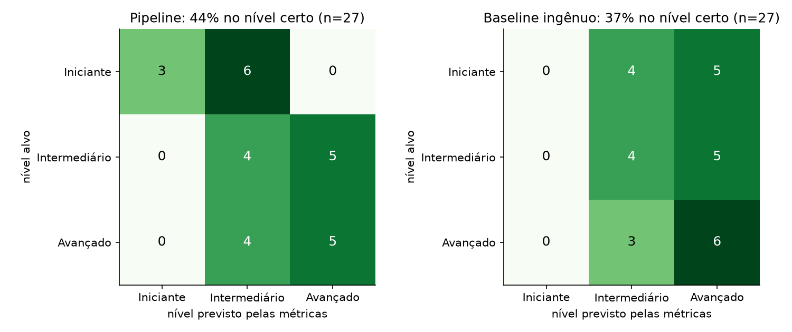
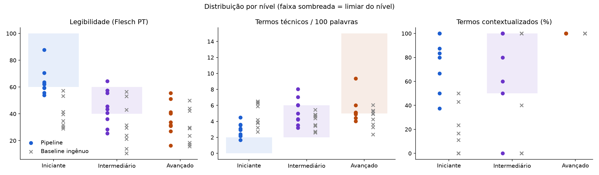
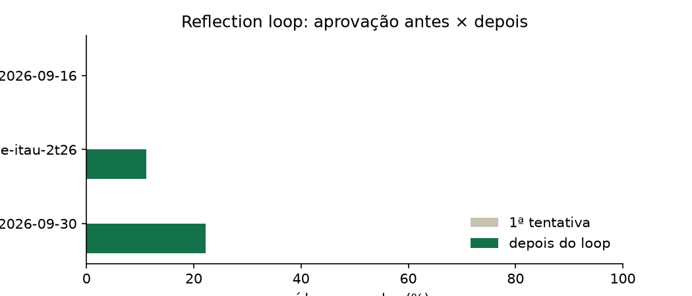
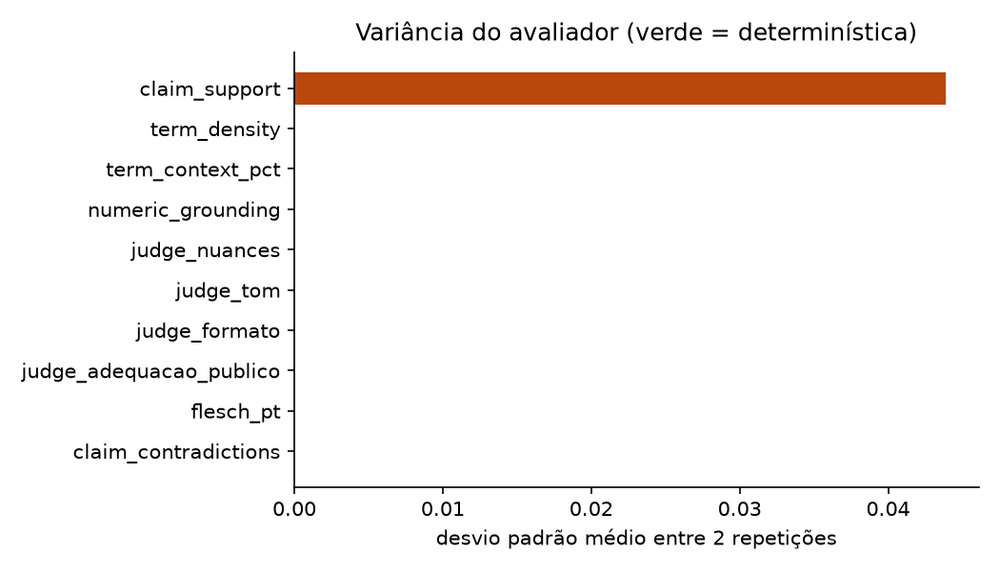
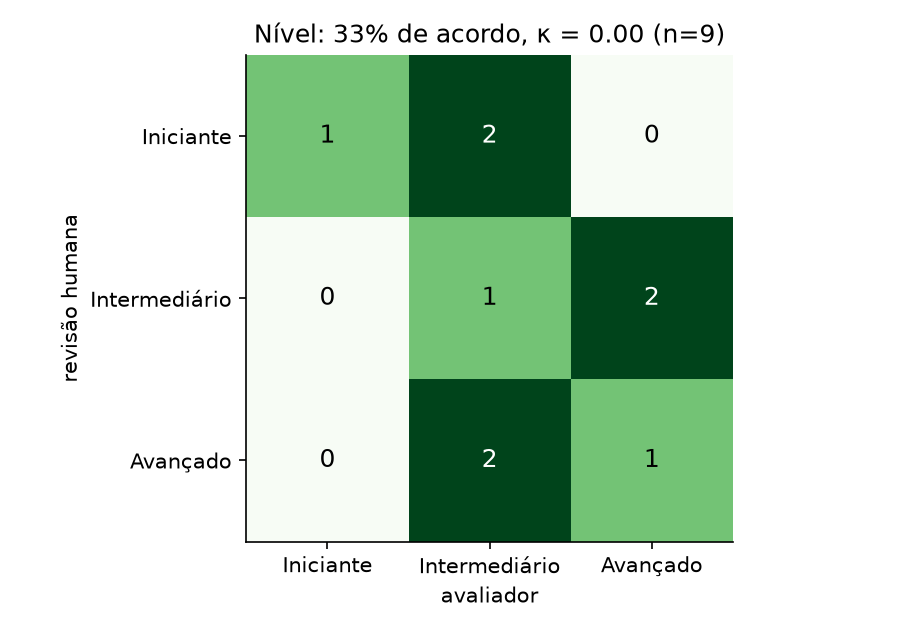
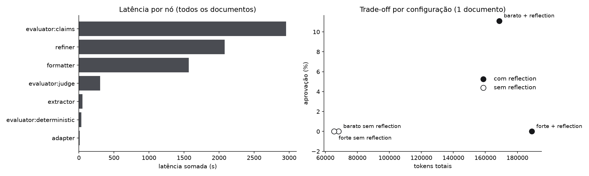

# Relatório experimental · 2026-10-17

## 1. Configuração e reprodutibilidade

- Commit: `cb95487679f1f661993855bcc5d38088e0b127df-dirty`
- Modelos: fast = `groq:openai/gpt-oss-20b`, strong = `groq:openai/gpt-oss-120b`, judge = `groq:qwen/qwen3.8-27b`, claims = `groq:openai/gpt-oss-120b`
- Temperatura: geração 0.2, avaliação 0.0
- Reflection: até 3 tentativas por saída; parada se a nota agregada subir menos que 0.01
- Hashes: prompts_geracao `45574b5dc45e`, prompts_avaliador `5df02f1cff2b`, prompt_baseline `5cabb0a0e1b2`, thresholds `a1bcaf1b7d20`, glossario `76573aab2c56`
- Documentos: `fato-relevante-banco-bradesco-s-a-2026-10-08__fato-relevante-banco-bradesco-s-a-2026-09-30` (principal), `release-itau-2t26` (principal), `ata-copom-2026-09-16` (principal)

Tudo foi gerado por `uv run python -m backend.experiments` a partir de `manifest.json`; as tabelas abaixo saem de `csv/`.

## 2. Metodologia de avaliação

Cada saída passa pelo Avaliador Híbrido. As métricas determinísticas vêm primeiro e o LLM só entra onde regra não resolve:

| Métrica | Tipo | Regra |
|---|---|---|
| `flesch_pt` | determinística | Flesch de Martins et al. (248,835 − 1,015·palavras/frase − 84,6·sílabas/palavra), sílabas por pyphen pt_BR |
| `term_density` | determinística | termos do glossário (lema spaCy + variações) por 100 palavras |
| `term_context_pct` | determinística | % dos termos acima do nível com explicação na mesma frase, na anterior ou na seguinte por anáfora |
| `numeric_grounding` | determinística | números sem correspondência na fonte (aceita arredondamento e mudança de unidade) |
| `claim_support`, `claim_contradictions` | LLM, temp. 0 | afirmações atômicas contra as âncoras; contradição reprova |
| `judge_*` | LLM, temp. 0 | 4 critérios de 1 a 5 com trecho literal como evidência; tamanho do texto não é critério |

O nível previsto de cada saída vem só de Flesch e densidade (as métricas que não dependem do nível pedido). O baseline é um prompt único (“resuma para um investidor X no formato Y”), sem extractor, âncoras ou glossário, avaliado com a mesma suíte.

## 3. Calibração dos limiares

Limiares usados (`thresholds.yaml`):

| nível | flesch_pt | term_density | term_context_pct |
|---|---|---|---|
| iniciante | {"min": 60} | {"max": 2} | {"min": 100} |
| intermediario | {"min": 40, "max": 60} | {"min": 2, "max": 6} | {"min": 50} |
| avancado | {} | {"min": 5} | {} |

Os limiares são os do briefing. A calibração rodou em 7 textos golden escritos à mão, não nas saídas avaliadas aqui. Por isso não há vazamento entre calibração e avaliação; a contrapartida é que os limiares não foram ajustados com dados reais (ver Limitações).

## 4. Resultados

### 4.1 Baseline × pipeline

Aprovação geral: **pipeline 11%** × baseline 0% (27 e 27 saídas).

| system | audience | saidas | aprovacao | flesch_pt | term_density | term_context_pct | claim_support | judge_adequacao_publico | judge_nuances |
|---|---|---|---|---|---|---|---|---|---|
| baseline | avancado | 9 | 0.0 | 30.047 | 4.451 | 100.0 | 0.6 | 3.444 | 3.222 |
| baseline | iniciante | 9 | 0.0 | 39.869 | 4.759 | 16.019 | 0.632 | 2.0 | 2.333 |
| baseline | intermediario | 9 | 0.0 | 31.481 | 4.044 | 48.889 | 0.625 | 3.778 | 3.111 |
| pipeline | avancado | 9 | 0.222 | 36.454 | 5.446 | 100.0 | 0.943 | 4.889 | 4.0 |
| pipeline | iniciante | 9 | 0.0 | 63.829 | 2.894 | 78.333 | 0.887 | 4.111 | 3.111 |
| pipeline | intermediario | 9 | 0.111 | 44.122 | 5.263 | 76.667 | 0.922 | 3.778 | 3.667 |

### 4.2 Matriz de confusão de níveis

Acurácia de nível: **pipeline 44%** × baseline 37%.

### 4.3 Distribuição das métricas por nível

### Reflection loop

| doc_id | cells | pct_approved_first | pct_approved_final | mean_attempts | refined_cells | stagnated | regressions | extra_llm_calls | extra_tokens | extra_cost_usd | extra_latency_s | split |
|---|---|---|---|---|---|---|---|---|---|---|---|---|
| fato-relevante-banco-bradesco-s-a-2026-10-08__fato-relevante-banco-bradesco-s-a-2026-09-30 | 9 | 0.0 | 22.2 | 2.56 | 9 | 2 | 4 | 42 | 105458 | 0.051939 | 1301.83 | principal |
| release-itau-2t26 | 9 | 0.0 | 11.1 | 2.56 | 9 | 4 | 15 | 42 | 100311 | 0.047789 | 1145.25 | principal |
| ata-copom-2026-09-16 | 9 | 0.0 | 0.0 | 2.56 | 9 | 4 | 11 | 42 | 111127 | 0.052592 | 1468.95 | principal |

Média: aprovação na 1ª tentativa 0.0% → depois do loop 11.1%, 2.56 tentativas por saída, 30 regressão(ões) detectada(s).

### Variância do avaliador (2 repetições sobre as mesmas saídas)

A 1ª repetição é a avaliação feita durante a execução principal; as demais reavaliam as mesmas saídas.

Métricas determinísticas: desvio máximo **0** (devem ser 0).

| metric | media | desvio_medio_entre_repeticoes | desvio_max | tipo | repeticoes |
|---|---|---|---|---|---|
| claim_contradictions | 0.0 | 0.0 | 0.0 | llm | 2 |
| claim_support | 0.8991 | 0.0439 | 0.1768 | llm | 2 |
| flesch_pt | 44.8722 | 0.0 | 0.0 | deterministica | 2 |
| judge_adequacao_publico | 4.3333 | 0.0 | 0.0 | llm | 2 |
| judge_formato | 3.6667 | 0.0 | 0.0 | llm | 2 |
| judge_nuances | 4.4444 | 0.0 | 0.0 | llm | 2 |
| judge_tom | 5.0 | 0.0 | 0.0 | llm | 2 |
| numeric_grounding | 0.4444 | 0.0 | 0.0 | deterministica | 2 |
| term_context_pct | 85.2778 | 0.0 | 0.0 | deterministica | 2 |
| term_density | 4.2989 | 0.0 | 0.0 | deterministica | 2 |

## 5. Concordância humano × avaliador

<!-- concordancia:inicio -->

Revisão cega: o revisor viu só o texto e o formato, sem nível-alvo nem notas do avaliador.

| dimensao | n | concordancia | ic95_inf | ic95_sup | kappa_cohen |
|---|---|---|---|---|---|
| nivel (percebido x previsto) | 9 | 0.333 | 0.121 | 0.646 | 0.0 |
| nivel (percebido x alvo) | 9 | 0.556 | 0.267 | 0.811 | 0.333 |
| erro factual | 0 |  |  |  |  |
| trivializou | 0 |  |  |  |  |
| tom (erro absoluto médio, 1-5) | 9 | 0.111 |  |  |  |

- No nível, humano e avaliador concordam em 3 de 9 saídas (33%; IC 95% de Wilson 12%–65%). Kappa = 0.00 (fraco).
- O nível percebido pelo revisor coincide com o nível pedido na geração em 5 de 9 saídas (56%).
- Em erro factual: não avaliado na revisão humana.
- Em trivialização: não avaliado na revisão humana.
- No tom, o judge erra em média 0.11 ponto(s) na escala de 1 a 5.

**Leitura honesta.** Com n = 9, cada discordância move a concordância em 11%. Os intervalos acima são largos: servem para ver a direção, não para afirmar que o avaliador equivale a um humano. O kappa também é instável com poucas saídas e classes desbalanceadas (ex.: se quase nenhuma saída tem erro factual, um único desacordo derruba o kappa mesmo com concordância alta). Há um único revisor, então não medimos a concordância entre humanos, que seria o teto realista para o avaliador. Todas as 9 saídas são do mesmo documento (Itaú 2T26).

Kappa de Cohen: < 0,2 fraco; 0,2–0,4 razoável; 0,4–0,6 moderado; 0,6–0,8 substancial; > 0,8 quase perfeito.

<!-- concordancia:fim -->

## 6. Trade-offs de custo e latência

Custo por documento:

| doc_id | system | split | llm_calls | input_tokens | output_tokens | cost_usd | wall_s |
|---|---|---|---|---|---|---|---|
| fato-relevante-banco-bradesco-s-a-2026-10-08__fato-relevante-banco-bradesco-s-a-2026-09-30 | pipeline | principal | 73 | 115629 | 54695 | 0.086307 | 632.37 |
| fato-relevante-banco-bradesco-s-a-2026-10-08__fato-relevante-banco-bradesco-s-a-2026-09-30 | baseline | principal | 27 | 37782 | 19498 | 0.032776 | 355.7 |
| release-itau-2t26 | pipeline | principal | 73 | 116400 | 52199 | 0.081692 | 617.37 |
| release-itau-2t26 | baseline | principal | 27 | 42378 | 21815 | 0.033501 | 535.44 |
| ata-copom-2026-09-16 | pipeline | principal | 73 | 123721 | 55770 | 0.087227 | 717.82 |
| ata-copom-2026-09-16 | baseline | principal | 27 | 59691 | 23174 | 0.036594 | 1070.41 |

Configurações no mesmo documento. A geração barata é a execução principal; a forte troca o modelo de adapters, formatters e refiner. A variante sem reflection é a 1ª tentativa de cada execução (com uma tentativa só, o grafo termina nessa avaliação); a latência dela é estimada pelo caminho crítico.

| config | modelo_geracao | max_tentativas | aprovacao | flesch_medio | densidade_media | fidelidade_media | tentativas_medias | chamadas_llm | tokens | custo_usd | latencia_s | latencia |
|---|---|---|---|---|---|---|---|---|---|---|---|---|
| barato + reflection | groq:openai/gpt-oss-20b | 3 | 0.111 | 44.87 | 4.3 | 0.912 | 2.56 | 73 | 168599 | 0.081692 | 617.37 | medida |
| barato sem reflection | groq:openai/gpt-oss-20b | 1 | 0.0 | 42.26 | 4.17 | 0.841 | 1.0 | 31 | 68288 | 0.033902 | 258.19 | estimada (caminho crítico) |
| forte + reflection | groq:openai/gpt-oss-120b | 3 | 0.0 | 47.7 | 4.66 | 0.855 | 2.89 | 82 | 188948 | 0.104743 | 1034.55 | medida |
| forte sem reflection | groq:openai/gpt-oss-120b | 1 | 0.0 | 39.8 | 4.11 | 0.873 | 1.0 | 31 | 65383 | 0.037097 | 334.38 | estimada (caminho crítico) |

## 7. Limitações

- **Limiares não calibrados com dados reais.** Vêm do briefing; a calibração usou só textos golden. Sem vazamento, mas sem ajuste empírico.
- **Amostra pequena.** Poucos documentos e 9 saídas por documento: as taxas têm intervalo de confiança largo.
- **O nível previsto usa só duas métricas** (Flesch e densidade); textos curtos (< 100 palavras) têm baixa confiabilidade e são sinalizados.
- **Sílabas por hifenização** (pyphen) erram alguns hiatos ("monetária" = 4), deixando o Flesch levemente otimista.
- **Grounding numérico tolerante** a inteiros pequenos, por comparar em várias escalas; a checagem semântica fica com o LLM.
- **Judge e checker de afirmações dependem de LLM** (ver variância); a concordância humana é a validação externa.
- **Custo em US$** depende de `backend/model_prices.yaml`; se vazio, só tokens e latência valem.

## 8. Próximos passos

- Calibrar os limiares com textos de referência por nível e validar no hold-out.
- Ampliar o corpus (mais tipos de documento) e repetir a revisão humana com mais de um avaliador.
- Revisar os 73 termos do glossário marcados como pendentes.
